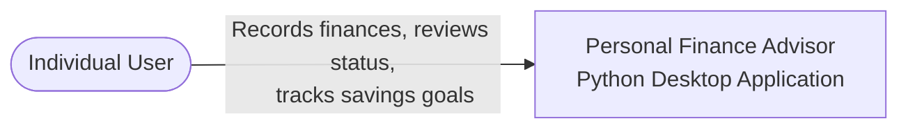
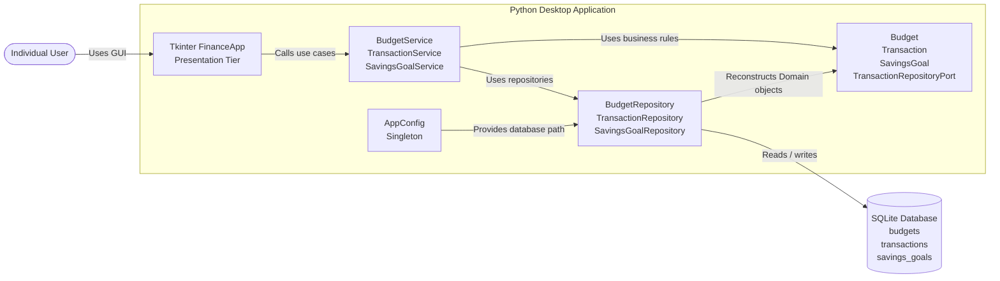
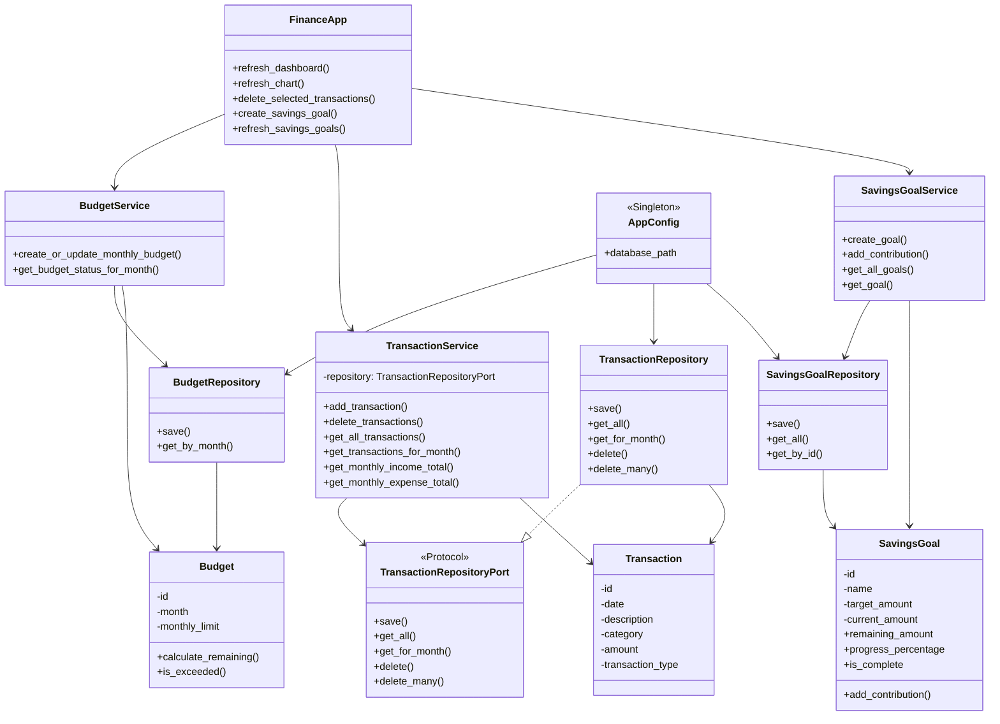
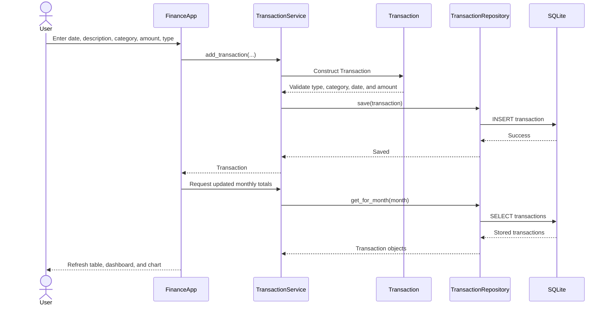

# Personal Finance Advisor

[](https://github.com/Jesse-Trueba/cen5064-project-trueba/actions/workflows/ci.yml)

**Student:** Jesse Trueba  
**Course:** CEN 5064 Software Design, Fall 2026  
**Partner:** @esway001

## Project

The Personal Finance Advisor is a Python desktop application for manual personal-finance tracking.

The completed application allows a user to:

- Record and categorize income and expense transactions.
- Delete one or multiple saved transactions.
- Create and update monthly budgets.
- Compare expenses against a monthly spending limit.
- View monthly income, expenses, available funds, and budget status.
- View expenses grouped by category in a graphical chart.
- Create savings goals, add contributions, and track progress.

The application uses a four-tier architecture consisting of Presentation, Service, Domain, and Data responsibilities.

The final system is intentionally a local, single-user application. Live bank connectivity, authentication, cloud synchronization, OCR import, and financial advice are outside the approved project scope.

## How to Run

1. Clone the repository and open a terminal in the project folder.

2. Create and activate a Python virtual environment.

Windows:

```powershell
python -m venv .venv
.venv\Scripts\activate
```

macOS/Linux:

```bash
python3 -m venv .venv
source .venv/bin/activate
```

3. Install the project dependencies.

```bash
pip install -r requirements.txt
```

4. Run the graphical application.

```bash
python -m presentation.finance_gui
```

The final graphical application contains five tabs:

- Dashboard
- Transactions
- Budget
- Charts
- Savings Goals

The older `presentation.budget_cli` module remains from the first working slice but is not the primary final interface.

## Verification

Run the automated tests:

```bash
python -m pytest
```

Run the Ruff quality check:

```bash
python -m ruff check .
```

## Architecture

### Tier Breakdown

| Tier | Responsibilities in this system | Main modules |
| --- | --- | --- |
| Presentation | Collects user input and displays financial information through the Tkinter graphical interface. Includes forms, tables, dashboard values, deletion controls, charts, and savings-goal controls. | `presentation/finance_gui.py` |
| Service | Coordinates application use cases without implementing GUI behavior or SQL. | `BudgetService`, `TransactionService`, `SavingsGoalService` |
| Domain | Contains financial entities, validation, calculations, and business rules independent of Tkinter and SQLite. | `Budget`, `Transaction`, `SavingsGoal`, `TransactionRepositoryPort` |
| Data | Initializes SQLite, stores and retrieves records, converts database rows into Domain objects, and handles transaction deletion. | `database.py`, `BudgetRepository`, `TransactionRepository`, `SavingsGoalRepository` |

### Dependency Rule

The Presentation tier communicates with Service objects instead of directly accessing SQLite or implementing financial business rules.

Services coordinate Domain and Data responsibilities.

Domain entities remain independent of both Tkinter and SQLite.

Repositories translate between SQLite rows and Domain objects.

`TransactionService` depends on `TransactionRepositoryPort` rather than directly depending on the concrete SQLite repository. This is the project's primary Dependency Inversion Principle refactor.

## C4 Architecture

### Context Diagram



The Personal Finance Advisor is a local desktop system used by one individual user. Financial information is entered manually. There are no external banking or authentication systems in the final scope.

### Container / Tier Diagram



The final deployment footprint consists of the Python desktop application and a local SQLite database.

## UML Design

### Final Class Diagram



The final diagram represents implemented classes rather than planned features.

`Transaction`, `Budget`, and `SavingsGoal` contain Domain behavior. Repository classes handle SQLite persistence. `TransactionRepositoryPort` provides the abstraction used by `TransactionService`, while `AppConfig` is the project's selected Singleton configuration object.

### Sequence Diagram — Add Categorized Transaction



Domain validation occurs before persistence. The GUI does not execute SQL directly.

## Final Features

### Transactions

Transactions include:

- Date
- Description
- Category
- Amount
- Income or expense type

Expense and income categories are validated separately in the Domain layer.

The GUI supports multi-selection so one or multiple transactions can be deleted from SQLite.

### Monthly Budgets

Users can create or update a monthly spending limit.

Expenses are compared against the monthly budget to determine whether the user is:

- `WITHIN BUDGET`
- `OVER BUDGET`

### Dashboard

The Dashboard displays:

- Budget
- Income
- Expenses
- Available Funds
- Status

Available Funds is displayed as:

```text
Budget + Income - Expenses
```

The Refresh Dashboard button reloads the current persisted transaction totals.

### Charts

The Charts tab displays monthly expense totals grouped by category.

The chart is refreshed after transaction changes.

### Savings Goals

Users can:

- Create a savings goal.
- Set a target amount.
- Add contributions.
- View the amount saved.
- View the amount remaining.
- View progress percentage.
- See when the goal is complete.

Savings goals persist in SQLite between application sessions.

## SOLID Principle

### Dependency Inversion Principle

The project's primary SOLID refactor applies Dependency Inversion to transaction persistence.

`TransactionService` depends on the `TransactionRepositoryPort` Protocol rather than directly depending on `TransactionRepository`.

The concrete SQLite repository implements that contract, while automated tests can substitute a fake repository without using the database.

## Creational Design Patterns

### Singleton — Applied

`AppConfig` is implemented as a Singleton.

It provides one shared application configuration containing the default SQLite database path.

The configuration value is injected into repositories rather than being used as a global service locator.

### Patterns Deliberately Not Used

| Pattern | Reason |
| --- | --- |
| Factory Method | The project does not have subclasses that need to choose between product implementations. |
| Abstract Factory | The application does not create families of related products. |
| Builder | `Budget`, `Transaction`, and `SavingsGoal` are straightforward to construct and do not require complex staged construction. |
| Prototype | The application does not need to clone preconfigured object templates. |

The full pattern mapping is documented in [`docs/pattern-map.md`](docs/pattern-map.md).

## Architecture Decision Records

Architecture decisions are stored in [`docs/adr/`](docs/adr/).

| ADR | Decision | Status |
| --- | --- | --- |
| [ADR-001](docs/adr/adr-001-four-tier-architecture.md) | Four-tier architecture | Accepted |
| [ADR-002](docs/adr/adr-002-manual-financial-entry.md) | Manual financial entry | Accepted |
| [ADR-003](docs/adr/adr-003-tkinter-gui.md) | Tkinter graphical user interface | Accepted |
| [ADR-004](docs/adr/adr-004-sqlite-database.md) | SQLite persistent storage | Accepted |

## Feedback Addressed

### Midterm Action Items

- Completed the categorized transaction use case with a Domain rule and automated tests.
- Replaced the command-line-only experience with a real Tkinter graphical interface.
- Replaced JSON persistence with SQLite behind repository classes.

### Final Check-In Action Items

- Added deletion of one or multiple selected transactions.
- Added Income and Expenses to the Dashboard.
- Fixed Dashboard refresh behavior using persisted transaction information.
- Added Available Funds.
- Added a Charts tab based on stored transactions.

### Peer Review Follow-Up

Savings Goals were originally shown in the design before their implementation was complete.

The final system now includes:

- `SavingsGoal` Domain model
- `SavingsGoalRepository`
- `SavingsGoalService`
- Savings Goals GUI tab
- SQLite persistence
- Contribution tracking
- Automated tests

## Weekly Log

### Week 1 — Aug. 24–30
- Set up the GitHub repository from the course template.
- Defined the Personal Finance Advisor scope and core features.
- Established the initial four-tier architecture.

### Week 2 — Aug. 31–Sept. 6
- Refined the README and tier breakdown.
- Identified Presentation, Service, Domain, and Data responsibilities.
- Continued planning core classes and features.

### Week 3 — Sept. 7–13
- Refined project requirements and use cases.
- Prepared the architecture for C4 and UML design work.

### Week 4 — Sept. 14–20
- Added C4 Context and Container diagrams.
- Added the UML class diagram.
- Added a sequence diagram for a core workflow.

### Week 5 — Sept. 21–27
- Began using the issue → branch → commit → pull request → review → merge workflow.
- Created GitHub issues with acceptance criteria.
- Participated in peer pull-request reviews.

### Week 6 — Sept. 28–Oct. 4
- Used the AI-assisted development workflow to implement Budget Domain logic.
- Added automated tests.
- Verified and corrected AI-assisted code through testing and review.

### Week 7 — Oct. 5–11
- Added and verified CI with Ruff and pytest.
- Added initial ADRs.
- Implemented the first end-to-end budget working slice.
- Added initial persistence and midterm documentation.

### Week 8 — Oct. 12–18
- Completed the midterm delivery and peer-review process.
- Continued transaction Domain and persistence work.

### Week 9 — Oct. 19–25
- Completed the categorized-transactions use case.
- Added Domain validation and automated transaction tests.
- Merged the transaction working slice through pull-request review.

### Week 10 — Oct. 26–Nov. 1
- Added the Tkinter graphical interface.
- Replaced JSON persistence with SQLite.
- Connected budgets and transactions to the GUI.

### Week 11 — Nov. 2–8
- Applied Dependency Inversion to `TransactionService`.
- Added `TransactionRepositoryPort`.
- Added the Singleton `AppConfig`.
- Completed the creational pattern map.

### Week 12 — Nov. 9–15
- Completed the final check-in action items.
- Added multi-select transaction deletion.
- Added Income, Expenses, and Available Funds to the Dashboard.
- Fixed Dashboard refresh behavior.
- Added the Charts tab.

### Week 13 — Nov. 16–Final
- Completed the Savings Goals working slice.
- Added Savings Goal Domain, Service, Repository, GUI, tests, and SQLite persistence.
- Added GUI and SQLite ADRs.
- Updated final architecture documentation.
- Completed final peer review, regression testing, PowerPoint, and demonstration video.

## Final Repository Reference

Repository:

```text
https://github.com/Jesse-Trueba/cen5064-project-trueba
```

Primary application command:

```bash
python -m presentation.finance_gui
```

Tests:

```bash
python -m pytest
```

Lint:

```bash
python -m ruff check .
```
